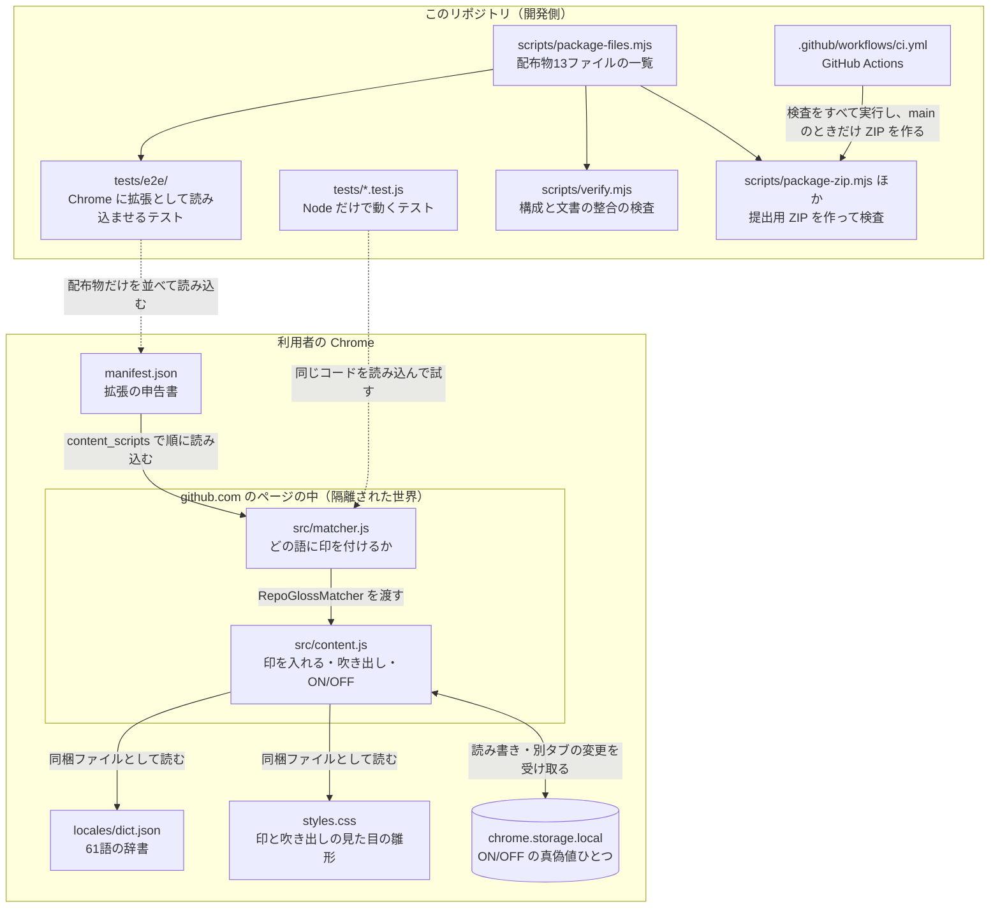

# RepoGloss の仕組み（持ち主向けの解説書）

この文書は、RepoGloss のコードがどう組み立てられているかを、エンジニアでない持ち主が読めるように説明するものです。拡張の動作には関係せず、配布物（ストアへ出す ZIP）にも入りません（配布物の一覧は `scripts/package-files.mjs`）。

## この文書の読み方

- 説明は、実際にファイルを開いて読んだ内容から書いています。根拠として「ファイルのパス：おおよその行」を添えました。行番号は 2026-10 時点の `main`（v1.8.22）でのおおよその位置で、コードが変われば少しずつずれます。
- **読んでいない部分は「未確認」と書いています。** 特に `src/content.js` の「見え方の幾何計算」（切り取り・変形・塗りの細部）と、`scripts/verify.mjs` の中ほど、E2E テストの本体は、全部は読んでいません。表の中で個別に示します。
- 用語は [GLOSSARY.md](./GLOSSARY.md) にまとめています。

---

## 1. 全体像

RepoGloss は、GitHub のページにある Git / GitHub の用語（辞書にある 61 語）の右に小さな ⓘ（以下「印」）を付け、そこにカーソルを乗せるか Tab で止まると、日本語の説明を吹き出しで出す Chrome 拡張です。

動く部品は、**GitHub のページの中で動く 2 本の JavaScript**（`src/matcher.js` と `src/content.js`）だけです。常駐する裏方の処理（background）や外部との通信はありません（`manifest.json` に `background` が無いこと、`fetch` が同梱ファイルの読み込みだけであることを `scripts/verify.mjs` がおおよそ 58 行目・93〜128 行目で検査しています。93〜128 行目の中身は見出しと一部しか読んでいないため、検査の細部は未確認）。

それ以外のファイルは、**検査（テスト）と、配布物を作る道具と、文書**です。

---

## 2. ファイルごとの役割

### 2-1. 拡張の本体（配布物に入るもの）

配布物（ZIP）に入るのは次の 13 ファイルです（`scripts/package-files.mjs:4-18`）。

| パス | 役割 | 根拠 |
|---|---|---|
| `manifest.json` | 拡張の申告書。名前・版（1.8.22）・最低の Chrome（105）・権限（`storage` だけ）・動かすページ（`https://github.com/*`）・読み込む JS の順番（`matcher.js` が先）を書く | `manifest.json:1-35` |
| `src/matcher.js` | 「どの語に、どこで印を付けるか」だけを決める部品。ページの部品（DOM）に触らないので、Node のテストからも同じものを呼べる | `src/matcher.js:1-10`, `92-140` |
| `src/content.js` | 本体。辞書を読み、ページの文章を調べ、見える語にだけ印を入れ、吹き出しを出し、ページの変化を見張り、右下の ON/OFF ボタンを置く。全体が 1 つの関数に包まれ、外から中身を触れない | `src/content.js:1-4`, `4476-4481` |
| `styles.css` | 印・吹き出し・ボタンの見た目の**雛形**。そのままでは使わず、`content.js` が読み込むたびに名前を書き換えてから入れる。後半の一区間は shadow root の中専用 | `styles.css:1-25`, `260`, `369`；`src/content.js:4406-4425` |
| `locales/dict.json` | 辞書。英語の用語（小文字）→ 日本語の説明。61 語 | `locales/dict.json`（冒頭数件のみ読んだ。語数は `npm test` の出力「辞書 61 語」で確認） |
| `icons/icon16.png` | ツールバー等のアイコン（16px） | `manifest.json:9-20`（画像の中身・出どころは未確認） |
| `icons/icon32.png` | 同（32px） | 同上 |
| `icons/icon48.png` | 同（48px） | 同上 |
| `icons/icon128.png` | 同（128px） | 同上 |
| `README.md` | 利用者向けの説明・変更履歴 | `README.md:1-153` |
| `DESIGN.md` | 設計メモ（語の選び方・判定の仕組み・既知の限界・測定記録） | 見出しのみ読んだ。本文は未確認 |
| `PRIVACY.md` | プライバシーポリシー（日本語・英語） | 見出しのみ読んだ。本文は未確認 |
| `LICENSE` | MIT ライセンス | `LICENSE:1-21` |

### 2-2. 検査（テスト）

| パス | 役割 | 根拠 |
|---|---|---|
| `tests/matcher.test.js` | 用語の判定（`matcher.js`）のテスト。辞書を読み込んで、拾う語・拾わない語を確かめる | 冒頭のみ読んだ（`tests/matcher.test.js:1-12`）。個々のテスト内容は未確認 |
| `tests/color-alpha.test.js` | 色の透明度（alpha）を読む関数のテスト。`content.js` からその関数の文字列だけを切り出して動かす | `tests/color-alpha.test.js:1-12` |
| `tests/package.test.js` | 提出用 ZIP の検査が、壊れた ZIP を本当に落とせるかを、1 件ずつ壊して確かめる | `tests/package.test.js:1-12` |
| `tests/provenance.test.js` | 提出物の「身元」の検査が、壊れた記録を本当に落とせるかを確かめる | `tests/provenance.test.js:1-12` |
| `tests/e2e/extension.e2e.mjs` | 本物の Chrome に拡張として読み込ませ、印・キーボード操作・ON/OFF・タブ間同期などを確かめる大きなテスト（約 5,800 行） | 冒頭 60 行のみ読んだ。個々のテストは未確認 |
| `tests/e2e/helpers/chrome.mjs` | E2E の道具。Chrome を探して起動し、github.com を手元の HTTPS サーバへ向ける（外へは通信しない）。試験用のページもここにある | `tests/e2e/helpers/chrome.mjs:1-90`（それより後ろは未確認） |
| `tests/e2e/batch-probe.js` | 試験専用。「まとめ直し」が何回走ったかを数える | 冒頭のみ読んだ |
| `tests/e2e/latent-probe.js` | 試験専用。控えの見直しが `checkVisibility` を何回呼ぶかを数える | 冒頭のみ読んだ |
| `tests/e2e/leak-probe.js` | 試験専用。わざと除外領域の文字を漏らし、計測が見逃さないことを示す対照 | 冒頭のみ読んだ |
| `tests/e2e/matcher-tap.js` | 試験専用。除外すべき領域の文字が辞書の照合まで届いていないかを測る | 冒頭のみ読んだ |
| `tests/e2e/no-checkvisibility.js` | 試験専用。`checkVisibility` が無い古い Chrome の状態を作る | 冒頭のみ読んだ |
| `tests/e2e/nodevalue-probe.js` | 試験専用。触れないと約束した領域の本文を、一度でも読んだかを測る | 冒頭のみ読んだ |
| `tests/e2e/timing-probe.js` | 試験専用。まとめ直し 1 回の時間と仕事量を測る | 冒頭のみ読んだ |

試験専用の JS は配布物に入れないことを `scripts/verify.mjs:1085-1101` が検査しています。

### 2-3. 配布物を作る道具・検査の道具

| パス | 役割 | 根拠 |
|---|---|---|
| `package.json` | 検査用のコマンドの置き場。依存パッケージは無い（`dependencies` が無い） | `package.json:1-13` |
| `scripts/verify.mjs` | 構成と文書の整合を約 410 件検査する。manifest の形・権限・外部通信の有無・`content.js` の約束事・文書の数字・監査資料と版の一致など | 全体の見出しと、`1-466` の検査名の一覧、`1085-1160`・`1468-1566`・`1692-1717` の本文を読んだ。`93-128` の中身、`467-1074`・`1158-1430`・`1567-1690` の細部は未確認 |
| `scripts/package-files.mjs` | 配布物 13 ファイルの一覧。**配布物の唯一の正本** | `scripts/package-files.mjs:1-18` |
| `scripts/package-stage.mjs` | 配布物だけを `dist/` に並べ、1 件ずつと全体のハッシュを出す。`--verify` で並べたものが今の中身と同じか確かめる | `scripts/package-stage.mjs:1-101` |
| `scripts/package-zip.mjs` | 提出用 ZIP を作り、開き直して検査し、身元の記録（どのコミット・どの CI 実行から出たか）を書く。commit していない変更があると止まる | `scripts/package-zip.mjs:1-155` |
| `scripts/zip.mjs` | 外部パッケージを使わない、自前の小さな ZIP 読み書き。日時を固定し、毎回同じバイト列になるようにしている | 冒頭 40 行のみ読んだ（`scripts/zip.mjs:1-40`）。残りは未確認 |
| `scripts/verify-zip.mjs` | ZIP の中身の検査（過不足・余計な親フォルダ・中身の一致・版・秘密らしいファイル名） | `scripts/verify-zip.mjs:1-71` |
| `scripts/provenance.mjs` | 身元の記録の検査。提出候補なら「CI の、このリポジトリの、main への push から出たもの」まで求める | `scripts/provenance.mjs:1-97` |
| `.github/workflows/ci.yml` | GitHub Actions。検査・E2E（Linux と Windows）・3 OS で配布物のハッシュが揃うか・main のときだけ提出用 ZIP を作る。権限は読み取りだけ | `.github/workflows/ci.yml:1-160` |

### 2-4. 文書・設定

| パス | 役割 | 根拠 |
|---|---|---|
| `AUDIT.md` | 外部監査の入口。冒頭の表と、機械が読む欄（`version:` `state:` `base_commit:` `commit:` `tag:`、`# CHANGED:` `# UNCHANGED:`）を `verify.mjs` が突き合わせる | `AUDIT.md:1-60`；`scripts/verify.mjs:1468-1566` |
| `SECURITY.md` | 脆弱性の報告先と、報告に含めてはいけないもの | `SECURITY.md:1-32` |
| `STORE_LISTING.md` | Chrome ウェブストアの掲載情報と、過去の提出物の記録 | 見出しのみ読んだ。本文は未確認 |
| `docs/audit/v1.8.3-changes.md` 〜 `docs/audit/v1.8.22-changes.md`（下の 20 件） | 版ごとの「何を直したか・どう確かめたか」の記録（監査の証拠） | `docs/audit/v1.8.21-changes.md:1-20` のみ読んだ。他は未確認 |
| `docs/audit/v1.8.3-changes.md` | 同上（v1.8.3） | 未確認 |
| `docs/audit/v1.8.4-changes.md` | 同上（v1.8.4） | 未確認 |
| `docs/audit/v1.8.5-changes.md` | 同上（v1.8.5） | 未確認 |
| `docs/audit/v1.8.6-changes.md` | 同上（v1.8.6） | 未確認 |
| `docs/audit/v1.8.7-changes.md` | 同上（v1.8.7） | 未確認 |
| `docs/audit/v1.8.8-changes.md` | 同上（v1.8.8） | 未確認 |
| `docs/audit/v1.8.9-changes.md` | 同上（v1.8.9） | 未確認 |
| `docs/audit/v1.8.10-changes.md` | 同上（v1.8.10） | 未確認 |
| `docs/audit/v1.8.11-changes.md` | 同上（v1.8.11） | 未確認 |
| `docs/audit/v1.8.12-changes.md` | 同上（v1.8.12） | 未確認 |
| `docs/audit/v1.8.13-changes.md` | 同上（v1.8.13） | 未確認 |
| `docs/audit/v1.8.14-changes.md` | 同上（v1.8.14） | 未確認 |
| `docs/audit/v1.8.15-changes.md` | 同上（v1.8.15） | 未確認 |
| `docs/audit/v1.8.16-changes.md` | 同上（v1.8.16） | 未確認 |
| `docs/audit/v1.8.17-changes.md` | 同上（v1.8.17） | 未確認 |
| `docs/audit/v1.8.18-changes.md` | 同上（v1.8.18） | 未確認 |
| `docs/audit/v1.8.19-changes.md` | 同上（v1.8.19） | 未確認 |
| `docs/audit/v1.8.20-changes.md` | 同上（v1.8.20） | 未確認 |
| `docs/audit/v1.8.21-changes.md` | 同上（v1.8.21） | 冒頭のみ読んだ |
| `docs/audit/v1.8.22-changes.md` | 同上（v1.8.22）。`verify.mjs` が今の版の記録があるかを検査する | `scripts/verify.mjs:1286-1288`（中身は未確認） |
| `docs/screenshot.png` | README に載せる画面の画像。配布物には入らない（README からは絶対 URL で参照） | `README.md:13`（画像そのものは未確認） |
| `docs/ARCHITECTURE.md` | この文書 | — |
| `docs/GLOSSARY.md` | 用語集 | — |
| `CLAUDE.md` | このリポジトリで作業する AI（Claude Code）への決まり | — |
| `.gitignore` | Git に入れないもの（OS のごみファイル・エディタ設定・`*.zip`・`dist/`） | `.gitignore:1-15` |
| `.gitattributes` | 改行を LF に固定する。OS で改行が揺れると配布物のハッシュが変わるため | `.gitattributes:1-6` |

---

## 3. 主な処理の流れ

### 3-1. ページを開いたとき（起動）

1. Chrome が `manifest.json` の指定どおり、`github.com` のページへ `src/matcher.js` → `src/content.js` の順に読み込む（`manifest.json:22-27`）。`matcher.js` は自分を `RepoGlossMatcher` という名前で置く（`src/matcher.js:5-9`）。
2. `content.js` は、読み込みのたびに変わる合言葉（`UID`）を作る（`src/content.js:10`）。ページ側と名前がぶつからないようにするためです。
3. 保存してある ON/OFF を `chrome.storage.local` から読む。未設定なら ON（`src/content.js:27-33`）。
4. 辞書 `locales/dict.json` と見た目の雛形 `styles.css` を同梱ファイルとして読む。読めない・空なら**何もしないで終わる**（`src/content.js:35-64`）。
5. 見た目の規則に合言葉を埋めて `<style>` として入れる（`scopeOwnStyle`、`src/content.js:4429-4442`）。
6. 吹き出しの見張りを張り（`bindTip`）、右下の ON/OFF ボタンを置き（`createToggle`）、ON なら走り出す（`applyEnabled` → `startRuntime`）（`src/content.js:4476-4481`, `4317-4325`）。
7. `startRuntime` は、ページの変化の見張り（MutationObserver）を先に始めてから、ページ全体を 1 回調べる（`scan(document.body)`）。続いて、遷移・画面の大きさ・スクロール・カーソル・クリックなどの合図を受け取る準備をし、定期の確認を予約する（`src/content.js:4252-4287`）。

### 3-2. 1 つの文章のかたまりに印を付けるまで

ページの文章は「テキストノード」という単位で並んでいます。`scan` はそれを 1 つずつ見ます（`scanInner`、`src/content.js:3500-3514`）。

1. **触ってよい場所か**を、文字を読む**前**に決める（`isTarget` → `inSkip`、`src/content.js:2089-2093`, `2075-2087`）。コード表示・入力欄・編集中の欄・`inert`・`hidden`・読み上げから隠された場所は除外（除外の一覧は `src/content.js:74-94`）。この順序は約束として `verify.mjs` が検査する（`scripts/verify.mjs:137-204` 付近）。
2. 辞書の語を含むかを正規表現で素早く調べる。含まなければ「処理済み」にして終わり（`src/content.js:2106`）。
3. 語ごとに、**その語の位置が実際に画面へ描かれているか**を調べる（`visibleHits` → `isVisibleOccurrence` → `isPaintedRange`、`src/content.js:2139-2152`, `2038-2064`, `1359-1418`）。答えは「見える」「見えない」「断定できない」の 3 通りで、**断定できないものには印を付けない**（`src/content.js:2122-2138`）。見えない・断定できない語は「控え」に入れ、あとで見え方が変わったら見直す（`rememberLatent`、`src/content.js:145-159`）。
   - 切り取り・変形・透明度・影・覆い・スクロールで届くかなどの細かい計算は `src/content.js` のおおよそ 210〜2020 行にあります。このうち `paintChain`（`1261-1312`）、`isPaintedRange`（`1359-1418`）、`iconIsPainted`（`1854-1927`）、スクロールの届き方（`1935-1994`）は読みましたが、**210〜1255 行と 1494〜1853 行の個々の計算は未確認**です。
4. 同じ語は**ページで最初の 1 回だけ**。既に「使える印」がある語は飛ばす（`usableGloss`、`src/content.js:3226-3231`）。
5. 入れる場所の種類を決める（`resolvePlacement`、`src/content.js:2232-2242`）。
   - ふつうの文章 → 印そのものが押せる（standalone）
   - リンクやボタンの中 → そのリンク自体を入口にし、印は飾り（hosted）
   - 操作部品の中だが Tab で止まれない → 今は付けない（skip、控えに入れる）
6. テキストを語の直後で割り、印（空の ``）を差し込む（`annotate`、`src/content.js:3369-3467`, `makeIcon` `2703-2716`）。ふつうの文章の印は、ページから複製されないよう **closed shadow root** の中に本物のボタンを持つ（`src/content.js:2502-2580`, `2718-2757`）。
7. **入れてから、印が本当に描かれているかを測る**（`iconIsPainted`、`src/content.js:3418-3430`, `1854-1927`）。描かれていなければ、押せなくしてから取り外し、その語は控えに戻す（`src/content.js:3431-3447`, `relinquishIcon` `2631-2636`）。
8. 描かれていれば「何を作ったか」を記録する（`glossed`、`src/content.js:3454-3459`；記録の入れ物は `169`）。この記録は後で片づけるときにだけ使う。

### 3-3. ページが変わったとき（まとめ直し）

GitHub はページを読み直さずに中身を差し替えます。そのため `content.js` は変化を見張り続けます。

1. 合図の出どころ：ページの部品の追加・削除・属性・文字の変化（MutationObserver、`src/content.js:3716-3772`）、`<html>` の属性（`3781-3785`）、`<head>` の stylesheet（`3789-3799`）、CSS のアニメーションの終わり・画面の大きさ・操作・スクロール・カーソル・遷移（`3957-3977`, `4156-4167`, `4277-4284`）。
2. 自分が起こした変化は数えない。自分が書く予定の「要素＋属性＋値」を予定表に控え、完全に一致した変化だけを自分のものとみなす（`setOwnAttr` / `consumeExpectedAttr`、`src/content.js:2304-2380`, `isSelfMutation` `3693-3702`）。
3. 合図はすべて `schedule` に集まり、同じ瞬間の合図は 1 回の「まとめ直し」（`runBatch`）にまとめられる（`src/content.js:3628-3637`）。
4. まとめ直しでやること（`runBatch`、`src/content.js:3639-3688`）：
   - 見た目の `<style>` が消されていないか確かめ、消されていれば入れ直す（`ensureOwnStyle`、`4463-4474`）
   - 記録した印が、まだ記録どおりで（`isCoherent` `3079-3171`）、まだ見えて押せるか（`isUsable` `3191-3224`）を確かめ、だめなら「退役」させる（`retireGloss` `3248-3275`）
   - URL が変わった・印が退役した → ページ全体を調べ直す（`reselect` `3303-3306`）
   - そうでなければ、変わった場所だけを調べ、見え方が変わったなら控えも見直す（`discoverLatent` `3551-3606`）
5. 控えの見直しは 1 回 8ms までで区切り、続きは次に回す（`src/content.js:3523`, `3557-3562`）。
6. 合図の出ない変化のために、定期の確認が 2 つある。
   - 暇なときの確認：約 2 秒ごと（`scheduleIdleCheck`、`src/content.js:4171-4193`）
   - 短い周期の見直し：控えの件数に応じて 0.4〜2 秒ごと（`scheduleFastCheck`、`src/content.js:4219-4247`）
   - カーソルによる見直しには CPU の使いすぎの上限（2 秒あたり 200ms）がある（`src/content.js:3997-4009`）。

### 3-4. 吹き出し

1. 見張りは document に 1 つずつだけ張る（`bindTip`、`src/content.js:2996-3058`）。
2. カーソルが印か入口に乗る・Tab で止まる → 説明を出す（`showTip`、`src/content.js:2887-2908`）。1 つのリンクに複数の用語があればまとめて出す（`buildTipBody` `2843-2866`）。
3. 吹き出しは画面からはみ出さないように置く（`placeTip` `2868-2884`）。スクロールでは閉じずに追いかけ、印が画面外へ出たら閉じる（`onViewportChange` `2911-2919`）。
4. 印から吹き出しへカーソルを移す途中の隙間では、0.25 秒待ってから閉じる（`TIP_GRACE_MS`、`src/content.js:2818-2829`, `leaveTip` `2970-2983`）。
5. Escape で閉じる。閉じたあと同じ印にフォーカスが戻っただけでは出し直さない（`src/content.js:2985-2994`, `3012-3025`）。

### 3-5. ON / OFF と、タブ間の同期

1. 右下のボタンを押すと、**本物の利用者の操作のときだけ**（`event.isTrusted`）切り替える。ページのスクリプトから押されたクリックでは設定を変えない（`src/content.js:4345-4358`）。
2. 先に表示を切り替え、次に `chrome.storage.local` へ保存する。保存に失敗したら表示を元へ戻す（`src/content.js:4359-4367`）。
3. OFF でも印は消さず、CSS で隠すだけ。見張りは止める（`applyEnabled` `4317-4325`, `stopRuntime` `4289-4312`, 隠す規則 `4419-4424`）。
4. 別のタブで切り替えると、保存の変化を受け取って、開いている GitHub のタブにも反映する（`src/content.js:4372-4381`）。

### 3-6. 配布物（ストアへ出す ZIP）ができるまで

1. 配布物の一覧は `scripts/package-files.mjs` だけが決める（13 ファイル）。
2. `npm run package:stage` が `dist/repogloss-<版>/` へ並べ、全体を 1 つのハッシュ（合算ハッシュ）にまとめる（`scripts/package-stage.mjs:76-101`）。CI はこれを Linux・Windows・macOS で実行し、3 つが同じ値かを機械で比べる（`.github/workflows/ci.yml:47-105`）。
3. `npm run package:zip` が ZIP を作る。commit していない変更があると止まる（`--allow-uncommitted` を付けたときだけ、名前に `UNCOMMITTED` を付けて作る）（`scripts/package-zip.mjs:46-81`）。作った ZIP を開き直して中身を検査し（`scripts/verify-zip.mjs`）、身元の記録 `dist/<zip名>.json` を書く（`scripts/package-zip.mjs:94-148`）。
4. CI では、検査・E2E・ハッシュ比較がすべて通り、かつ `main` への push のときだけ ZIP を作り、`--release` 付きでもう一度検査して成果物として残す（`.github/workflows/ci.yml:129-160`）。CI はストアへの提出はしない（`.github/workflows/ci.yml:3`）。

---

## 4. 検査の全体

| 検査 | 何を確かめるか | 実行のしかた |
|---|---|---|
| 構文検査 | 2 本の JS が文法として正しいか | `npm test` の最初（`package.json:5`） |
| Node のテスト | 用語の判定・色の透明度・ZIP 検査・身元検査 | `npm test`（`node --test "tests/**/*.test.js"`） |
| 構成と文書の整合 | manifest の形・権限・`content.js` の約束事・文書の数字・監査資料と版の一致 | `npm test` の最後（`node scripts/verify.mjs`） |
| E2E | 本物の Chrome に拡張として読み込ませた動作 | `npm run test:e2e`（Chrome と openssl が要る。Chrome の場所は `CHROME_PATH` でも指定できる：`tests/e2e/helpers/chrome.mjs:19-43`） |

`npm test` は 2026-10-26 に手元で実行し、Node のテスト 68 件がすべて成功、`verify.mjs` は「410 件を検査・不一致 0 件（辞書 61 語 / version 1.8.22）」でした。
